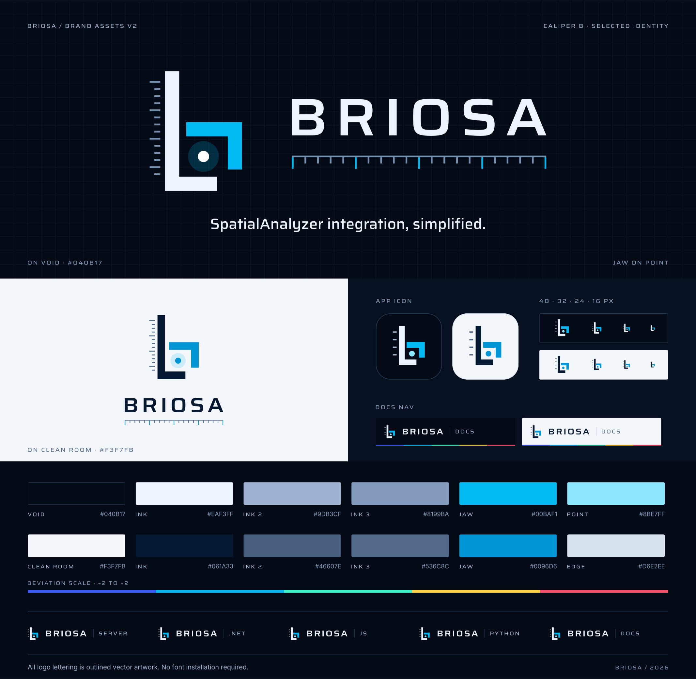

# Briosa Brand Assets

**SpatialAnalyzer integration, simplified.**

Brand version: **v2.2.0**. [Download the complete release pack](https://github.com/spatialanalyzer/briosa-brand/releases/download/v2.2.0/briosa-brand-v2.2.0.zip).



The identity is **Caliper b**: a lowercase b drawn as a caliper. Its beam carries vernier ticks, and a cyan jaw slides down the beam and closes on a measured point in the bowl of the b. The wordmark is **BRIOSA** in wide Saira capitals, with an optional vernier rule beneath it. The palette is dark-first: the mark is designed on void, `#040B17`, and has a matched light version for clean-room surfaces, `#F3F7FB`.

Every deliverable is vector paths and shapes, including the wordmark, slogan and product labels. No installed font or external resource is needed.

Around the identity sits an interface system, first built for the Scanline design of briosa.dev: surfaces, text-safe status colors, instrument motifs, motion rules, web and desktop fonts, and a WPF theme. See [Interface Motifs](#interface-motifs) and [Web and Application Use](#web-and-application-use).

## Choose an Asset

| Use | File |
| --- | --- |
| General logo on dark | [Horizontal inverse logo](logos/briosa-horizontal-inverse.svg) |
| General logo on light | [Horizontal color logo](logos/briosa-horizontal-color.svg) |
| Navigation bars, app headers, footers, under 250 px wide | [Compact horizontal logo](logos/briosa-horizontal-compact-inverse.svg) ([color](logos/briosa-horizontal-compact-color.svg)) |
| Desktop app navigation header that names the app | [Installer compact logo](suite/briosa-installer-compact-inverse.svg) or [Control Center compact logo](suite/briosa-control-center-compact-inverse.svg) |
| Splash screen, cover or hero | [Stacked inverse logo](logos/briosa-stacked-inverse.svg) |
| Hero or cover with the slogan | [Stacked logo with slogan](logos/briosa-stacked-tagline-inverse.svg) |
| Wide introduction with the slogan | [Horizontal logo with slogan](logos/briosa-horizontal-tagline-inverse.svg) |
| Wordmark by itself | [Wordmark](logos/briosa-wordmark-inverse.svg), or [with the vernier rule](logos/briosa-wordmark-ruled-inverse.svg) |
| Avatar or symbol, 64 px and up | [Symbol, large cut](marks/briosa-symbol-inverse.svg) |
| Symbol below 64 px | [Symbol, small cut](marks/briosa-symbol-small-inverse.svg) |
| Browser tab | [Favicon SVG](icons/favicon.svg), or the multisize ICO in the release pack |
| Application icon | [Dark tile](icons/app-icon.svg) or [light tile](icons/app-icon-light.svg) |
| OS-masked icon shape | [Full-bleed maskable icon](icons/app-icon-maskable.svg) |

`inverse` artwork is for dark backgrounds and `color` artwork for light ones. Every logo, wordmark and symbol also has `black` and `white` one-color versions. PNG counterparts are in the release pack's `png/` folder with matching filenames. Each SVG canvas includes a small safety margin; keep more clear space in the surrounding layout.

## The Mark

The mark is drawn on a 256-unit grid. Its geometry, colors and motion are recorded in [source/mark.json](source/mark.json).

- **Beam**: the stem and foot of the b, a square-ended L in ink.
- **Ticks**: vernier graduations to the left of the beam, in a quieter ink.
- **Jaw**: a cyan L beside the beam that closes on the point.
- **Point**: the measured point, centered in the bowl between the beam, the jaw and the foot.

Strokes are converted to filled outlines, so the artwork scales correctly in tools that do not scale strokes.

### Two Cuts

| Cut | Use | Detail |
| --- | --- | --- |
| Large | 64 px and up | Fifteen fine ticks, 24-unit strokes, a 9.5-unit point inside a soft cyan glow |
| Small | Below 64 px, app icons and favicons | Four heavy ticks, 30-unit strokes, a 15-unit point, no glow |

Sizes refer to the rendered 256-unit canvas. The small cut is designed and checked at 16, 24, 32 and 48 px; at 16 px the point is a soft two-pixel dot. The large cut's fine ticks blur below 64 px, so never use it there. The small cut stays correct at any larger size, which is why the app icons use it.

### Mark Colors

| Part | On dark (`inverse`) | On light (`color`) |
| --- | --- | --- |
| Beam | `#EAF3FF` | `#061A33` |
| Jaw | `#00BAF1` | `#0096D6` |
| Ticks | `#7690B0` large (`dark-tick`), `#9DB3CF` small | `#536C8C` |
| Point | `#FFFFFF` large, `#8BE7FF` small | `#0096D6` |
| Glow (large cut) | `#00BAF1`, radius 26, 20% opacity | `#00BAF1`, radius 24, 16% opacity |

One-color artwork uses a single color for every part and omits the glow.

### Motion

On screen, the mark moves in three ways. Each ends at rest, as the static files show it: the jaw closed on the point and the ring invisible. That is why the static files have no ring.

| Motion | When | Specification |
| --- | --- | --- |
| Load slide | Once, as a page or splash screen first shows the mark | The jaw starts 60 grid units up the beam and slides to rest; `1.1s cubic-bezier(.6,0,.3,1)` after `.3s`. Then the ring pings from the point; `.9s cubic-bezier(.2,.8,.2,1)` after `1.2s` |
| Reading | Once per pointer entry or keyboard focus on a linked mark, or once when a lockup first comes fully into view | The jaw opens up the beam by 60/208 of the beam's height, which is the load slide's 60 units on the small cut, and closes on the point again, 1 s in all. It opens during the first 40%, easing out (`cubic-bezier(.33,1,.68,1)`), and closes during the rest, easing in and out (`cubic-bezier(.65,0,.35,1)`). No ring. A reading in progress is not restarted |
| Showcase loop | Showcases only, such as a splash video or an identity sheet; never in product interfaces | 5 s cycle, jaw closed from 30% to 84%, ring pinging from 32% to 62% |

The ring is a circle on the point: radius 16 and 3-unit stroke on the large cut, radius 15 and 1.25 px stroke on the small cut; `#8BE7FF` on dark, `#0096D6` on light. It fades in to 95% opacity, then grows to 2.7 times while fading out.

These rules apply to the mark and to every looping motif in [Interface Motifs](#interface-motifs):

- **One-shot motion.** The load slide and readings run once per trigger, end at rest and finish within about 2 s. Never chain readings into a loop or start them on a timer.
- **Reduced motion.** When the system asks for reduced motion, through `prefers-reduced-motion: reduce` on the web or with Windows animation effects turned off on the desktop, show every motion's finished still: the closed mark with no load slide, readings or ring, scans fully drawn, and loops stopped. Hide a passing glint or scan band rather than freezing it mid-pass.
- **Pause control.** Motion that starts on its own, lasts more than 5 s and runs beside other content needs a visible control that pauses it ([WCAG 2.2.2](https://www.w3.org/WAI/WCAG22/Understanding/pause-stop-hide.html)). This covers the showcase loop, the spectral glint, scan lines and scan animations. Label the control with its action, such as Pause Motion and Play Motion. One control pauses every loop on the page, including navigation and footer loops, and each holds its current frame; one-shots may finish. Remember the choice for later visits, and hide the control under reduced motion, where nothing loops.
- **Desktop apps.** Keep windows still: no looping motion in app chrome or workspace artwork. If a header logo moves at all, it takes a reading. Show the static mark in Windows high contrast.

To animate an inlined SVG, target `[data-part="jaw"]` and add the ring as an unfilled circle on the point, at (141, 166) on the large cut or (144, 166) on the small cut. The load slide:

```css
.briosa-mark [data-part="jaw"] { animation: briosa-jaw 1.1s cubic-bezier(.6, 0, .3, 1) .3s both; }
.briosa-ring { opacity: 0; transform-box: fill-box; transform-origin: center;
  animation: briosa-ping .9s cubic-bezier(.2, .8, .2, 1) 1.2s both; }
@keyframes briosa-jaw { from { transform: translateY(-60px); } }
@keyframes briosa-ping { 0% { opacity: 0; transform: scale(1); } 8% { opacity: .95; } 100% { opacity: 0; transform: scale(2.7); } }
@media (prefers-reduced-motion: reduce) { .briosa-mark *, .briosa-ring { animation: none; } }
```

A reading on the small cut, in grid units; the large cut's 202-unit beam opens by 58.3:

```css
.briosa-reading [data-part="jaw"] { animation: briosa-read 1s linear; }
@keyframes briosa-read {
  0% { transform: none; animation-timing-function: cubic-bezier(.33, 1, .68, 1); }
  40% { transform: translateY(-60px); animation-timing-function: cubic-bezier(.65, 0, .35, 1); }
  100% { transform: none; }
}
@media (prefers-reduced-motion: reduce) { .briosa-reading [data-part="jaw"] { animation: none; } }
```

In WPF, animate the jaw's `TranslateTransform.Y` with a `CubicEase` in `EaseOut` mode for the opening and `EaseInOut` for the closing; these are the same curves.

## Wordmark and Vernier Rule

The wordmark is **BRIOSA** in Saira at weight 600 and width 125, with 0.14 em letter spacing, converted to outlines. Its source path and letter positions are in [source/wordmark.json](source/wordmark.json).

The optional vernier rule hangs below the wordmark like a caliper's scale. At a 60 px wordmark it is a 2 px line in the tick color, with 2 px ticks below it: minor ticks 7 px long, and jaw-colored major ticks 13 px long. The rule spans the wordmark exactly, from the B's stem to the A's foot, in twenty divisions of about 14 px with a major tick at every fifth. Its line sits 23 px below the baseline. It scales with the wordmark.

In the horizontal lockups, the ruled wordmark is centered on the mark's grid and the rule's line runs through the measured point. In the compact lockup, the baseline runs through the point.

## Color

All artwork uses solid sRGB fills, apart from the large cut's glow. Reusable tokens are in [colors.css](colors.css) and [colors.json](colors.json), whose `themes` give each theme's interface roles, and the WPF theme in [desktop/BriosaTheme.xaml](desktop/BriosaTheme.xaml).

### Dark

| Token | Hex | Role |
| --- | --- | --- |
| `void` | `#040B17` | Dark background |
| `dark-ink` | `#EAF3FF` | Beam, wordmark, primary text |
| `dark-ink-2` | `#9DB3CF` | Secondary text, product labels, small-cut ticks |
| `dark-ink-3` | `#8199BA` | Tertiary text and HUD labels on any dark surface |
| `dark-tick` | `#7690B0` | Large-cut ticks, vernier rule and other tick artwork; not for text |
| `dark-jaw` | `#00BAF1` | Jaw, major ticks, links and accents |
| `dark-point` | `#FFFFFF` | Large-cut point |
| `dark-point-small` | `#8BE7FF` | Small-cut point, motion ring |
| `dark-edge` | `#223A53` | Icon tile edge and dividers; `rgba(120,190,255,.26)` over void |

### Light

| Token | Hex | Role |
| --- | --- | --- |
| `clean-room` | `#F3F7FB` | Light background |
| `light-ink` | `#061A33` | Beam, wordmark, primary text |
| `light-ink-2` | `#46607E` | Secondary text, product labels |
| `light-ink-3` | `#536C8C` | Ticks, vernier rule, tertiary text |
| `light-jaw` | `#0096D6` | Jaw, major ticks, point, motion ring |
| `light-link` | `#006DB6` | Links and accent text |
| `light-edge` | `#D6E2EE` | Icon tile edge |
| `light-line` | `#B9C9DB` | Dividers; `rgba(0,56,117,.24)` over clean room |

Light ticks and the light vernier rule use `light-ink-3`, which is also safe as text.

### Surfaces

Interfaces build on four surfaces per theme: the ground, a deep band and two raised panels.

| Role | Dark | Light | Use |
| --- | --- | --- | --- |
| Ground | `void` `#040B17` | `clean-room` `#F3F7FB` | Page and window background |
| Deep | `dark-deep` `#071A33` | `light-deep` `#E7EFF7` | Alternate bands, drawers and sidebars |
| Panel | `dark-panel` `#0B2546` | `light-panel` `#FFFFFF` | Cards, tables, menus and fields |
| Panel 2 | `dark-panel-2` `#0E2C53` | `light-panel-2` `#F7FAFD` | Table heads and raised areas inside a panel |

Every text role passes 4.5:1 on all four surfaces of its theme. Lines are the theme's line tint, `line-tint` in `colors.json`, at a set opacity: `#78BEFF` on dark and `#003875` on light. `dark-edge` and `light-line` are the rule weight flattened on each ground.

| Line | Dark | Light | Use |
| --- | --- | --- | --- |
| Grid | Tint at 6% | Tint at 6% | Measurement grids |
| Hairline | Tint at 14% | Tint at 14% | Row dividers, minor ticks, rules inside panels |
| Rule | Tint at 26% | Tint at 24% | Panel borders, major ticks, sidebar beams |
| Strong | `#8BE7FF` at 50% | `#006DB6` at 50% | Hover borders, bracket frames on large objects |

### Status

Status colors are the deviation scale made text-safe. Each reads at 4.5:1 or more as a 10.5 px pill label on an 11% tint of itself, over every surface of its theme. Undecided is neutral; the others take the hue of one deviation step.

| Status | Meaning | Step | Dark | Light |
| --- | --- | --- | --- | --- |
| Current | Supported now; healthy, in tolerance | 0 | `#34F5C5` | `#076A55` |
| Next | Planned or in progress | −1 | `#00BAF1` | `#0062A6` |
| Undecided | An open question, not yet assessed | — | `#9DB3CF` | `#4A6280` |
| Uncommitted | Possible but not promised; a warning | +1 | `#FFD23F` | `#805300` |
| Excluded | Ruled out, failed or out of tolerance | +2 | `#FF7E95` | `#B81E40` |
| Unavailable | Not offered by the platform underneath, such as the SA SDK | −2 | `#9CAEFF` | `#3B4BC8` |

The tokens are `--briosa-dark-status-current` and so on in `colors.css`, `themes.dark.status.current` in `colors.json`, and `BriosaDarkStatusCurrentColor` in the WPF theme. Always pair a status color with its label: color is never the only cue.

### Deviation Scale

A five-step scale from a scan's deviation color map, from −2 to +2 standard deviations. It is a data scale and Scanline's signature palette. Use it:

- for data: deviation color maps, point clouds and their legends;
- for severity: the segments of a [severity gauge](#severity-gauges). Status pills and meters use the status colors, the scale's text-safe form;
- as the spectral signature: the 2 px [spectral bar](#spectral-bar) along a page edge, and the colored point clouds of hero illustrations.

Never use it in the logo, as a background or large fill, or as decoration that suggests data where there is none. When steps appear together, keep their order from −2 to +2.

| Step | Dark | Light |
| --- | --- | --- |
| −2 | `#3E5BFF` artwork only | `#2E47D9` |
| −1 | `#00BAF1` | `#0096D6` artwork only |
| 0 | `#34F5C5` | `#10A985` artwork only |
| +1 | `#FFD23F` | `#D99A00` artwork only |
| +2 | `#FF4D6D` artwork only | `#DE2F55` artwork only |

A step marked artwork only falls below 4.5:1 as text on at least one surface of its theme; light 0, for example, is 2.77:1 and +1 is 2.28:1 on clean room. Set text in the step's hue with its status color: −2 unavailable, −1 next, 0 current, +1 uncommitted and +2 excluded.

**−1 and the jaw.** Step −1 is the jaw cyan in both themes, by design: the brand's cyan sits inside the measurement scale. Context gives it one meaning at a time. In a color map, legend or gauge it means one deviation below nominal; everywhere else it is the accent. Where both could meet, as in a chart or point cloud with controls, keep the accent out of the plot: show selection and focus there in ink, and let the legend explain the data.

### Contrast

On void, `dark-ink` is **17.61:1**, `dark-ink-2` **9.18:1**, `dark-ink-3` **6.76:1** and `dark-jaw` **8.72:1**. On clean room, `light-ink` is **16.21:1**, `light-ink-2` **6.03:1**, `light-ink-3` **5.01:1** and `light-link` **5.05:1**. Every text role, from the inks and links to the status colors as text and as pills, passes 4.5:1 on all four surfaces of its theme. The closest are `dark-ink-3` on dark panel 2 at **4.79:1** and the light excluded pill on light deep at **4.60:1**. `light-jaw` is **3.08:1**: use it for artwork and large text only, and `light-link` for links. See [WCAG contrast guidance](https://www.w3.org/WAI/WCAG22/Understanding/contrast-minimum.html) and the [validation record](qa/VALIDATION.md), which measures every pair on each rebuild.

The `#00BAF1` cyan carries over from v1. A printer should make any required CMYK or spot-color conversion against a physical proof; the pack assigns no unverified Pantone match.

## Size and Space

| Asset | Canvas | Minimum |
| --- | --- | --- |
| Horizontal logo | 735 × 266 | 250 px wide |
| Horizontal logo with slogan | 735 × 271 | 440 px wide |
| Stacked logo | 375 × 411 | 180 px wide |
| Stacked logo with slogan | 375 × 441 | 320 px wide |
| Compact horizontal logo | 511 × 136 | 100 px wide |
| Wordmark | 630 × 133 | 80 px wide |
| Ruled wordmark | 630 × 208 | 160 px wide |
| Symbol, large cut | 256 × 256 | 64 px |
| Symbol, small cut | 256 × 256 | 16 px; use the large cut from 64 px |
| Suite lockups | 667 to 845 × 136 | 28 px tall |
| Compact product logos | 511 × 142 to 147 | 170 px wide |

The minimums keep the vernier rule at least 1 px, the slogan at about 14 px and product labels at about 9 px. Below the horizontal logo's minimum, use the compact logo, whose small-cut mark stays legible. At smaller sizes, drop the slogan and set it as readable text instead.

- Keep clear space of at least the height of the wordmark's capitals around any lockup. The symbol's 256-unit canvas already includes its clear space; do not crop it.
- Preserve aspect ratio. Do not rotate, skew, recolor or rearrange the beam, jaw, ticks and point, and keep the jaw closed on the point in static use.
- Keep the jaw cyan in full-color artwork; on other backgrounds, choose the black or white one-color version.

## Typography and Wording

| Role | Typeface and settings | Desktop (WPF) |
| --- | --- | --- |
| Wordmark | Saira, weight 600, width 125, 0.14 em letter spacing, uppercase, outlined | Outlined artwork |
| Slogan in logos | Saira, weight 500, width 106, outlined | Outlined artwork |
| Product labels | Saira, weight 500, width 125, 0.16 em letter spacing, uppercase, outlined | Outlined artwork |
| Display and headings | Saira, weight 600, width 106 | Saira 106 SemiBold |
| Subheads and the slogan as text | Saira, weight 500, width 106 | Saira 106 Medium |
| [HUD labels](#hud-labels) | Saira, weight 500, width 125, 11 px, 0.16 em letter spacing, uppercase | Saira 125 Medium, uppercase |
| [Status pills](#status-pills) | Saira, weight 600, width 118, 10.5 px, 0.1 em letter spacing, uppercase | Saira 125 SemiBold, uppercase |
| Body and interface text | Inter, weight 400; 500 and 600 for emphasis | Inter Regular, Medium and SemiBold |
| Code, numbers and readouts | [JetBrains Mono](https://github.com/JetBrains/JetBrainsMono), weight 400; 500 for readouts; tabular figures | JetBrains Mono Regular and Medium |

`fonts/` holds the original Saira, Inter and JetBrains Mono variable fonts with their SIL Open Font Licenses. Two builds are made from them:

- `fonts/web/`: the same variable fonts in WOFF2, with every axis, and `fonts.css` with matching `@font-face` rules.
- `fonts/desktop/`: static instances for WPF. WPF cannot select a variable font's axes and would render Saira at its default instance, Thin. Each Saira width is its own family, `Saira 106` and `Saira 125`, in Medium and SemiBold. `Inter` comes in Regular, Medium and SemiBold at its 14 pt optical size, and `JetBrains Mono` in Regular and Medium.

WPF has no letter spacing, so desktop labels and pills are set without tracking. Use the supplied outlined wordmark rather than typing BRIOSA; interfaces that load Saira may set live text with the settings above.

Use the slogan exactly:

> SpatialAnalyzer integration, simplified.

Use this supporting product description where more explanation is needed:

> An open-source gRPC bridge to the SpatialAnalyzer SDK.

Write **Briosa** in prose; the capitals belong to the wordmark. Write **SpatialAnalyzer** as one word, with capital S and A. Product descriptions should explain that SpatialAnalyzer must be separately installed, licensed, and running.

## Interface Motifs

Beyond the logo, the measuring instrument becomes a handful of interface motifs. The measurements are briosa.dev's, in CSS pixels. Colors are the theme roles in [Color](#color), and the accent is the jaw cyan on dark and `light-link` on light. The [system proof](qa/VALIDATION.md#visual-proofs) shows the pills, meters and gauges on every surface.

### Corner Brackets

The instrument's lock-on frame: four L-shaped corners on an object's edge, with nothing between them.

- On buttons, cards and other small objects, the arms are 10 px long and 1.5 px thick, in the accent.
- On large frames, such as a scan stage or a target card, the arms are 14 to 22 px long and 1 px thick, in the strong line.
- On hover or keyboard focus, the brackets lock on: they move from 1 px to 6 px outside the object's edge over .45 s, `cubic-bezier(.2,.8,.2,1)`.

Bracket only what is measured, selected or targeted, such as a focused card, the scan stage or the current sidebar item, whose arms are 7 px. Never frame running text, and give an object one bracket frame at most.

### Hairline Grid and Scan Line

- **Grid**: 1 px lines in the grid line, 6% of the tint, on a square pitch: 56 px behind a hero and 40 px in a footer band. Mask it so that it fades out toward copy, and text never sits on the full-strength grid; the hero fades radially from its visual, the footer over its first 40%. Desktop workspaces draw the grid as still native geometry and drop it in high contrast.
- **Scan line**: a band 120 px tall that travels down a dark band at a steady speed, once every 14 s, behind the content. It runs from transparent to the jaw cyan at 5% at 92% of its height, then to `#8BE7FF` at 30% at its leading edge, all at 60% opacity.
- **Scan plane**: a scanned part, such as the hero's turbine blade, repeats an 11 s cycle: a 6.6 s sweep, a 2.4 s hold, a 1.5 s fade and a .5 s gap.

These are loops: they pause with the page's control, and under reduced motion the scan line is hidden and the part is drawn fully scanned. See [Motion](#motion).

### Vernier Rules

The vernier rule becomes a measuring edge. Keep its rhythm: ticks hang from the line at a steady pitch, with a major tick at every fifth.

| Rule | Line | Ticks |
| --- | --- | --- |
| Under a lockup | 1 px in the tick color, spanning the wordmark | 1 px wide: minor ticks 5 px long every 6 px in the tick color, major ticks 9 px long every 30 px in the jaw cyan |
| Ruler band across the top of a section | 1 px rule line | Major ticks 9 px long every 120 px in the rule line, minor ticks 5 px long every 24 px in the hairline |
| Section ruler above a heading | 1 px hairline, full width | 4 px long every 48 px in the rule line, from a 7 px origin tick in the accent |
| Sidebar beam | 1 px rule line, 10 px from the edge | A 5 px tick to each item, 9 px in the strong line on hover and 13 px in the accent for the current page, which also carries a 7 px measured point with a 9 px glow |

The desktop measurement grid ends in a vernier rule along its bottom edge.

### Spectral Bar

The deviation scale as a 2 px signature along a page edge: a continuous gradient with −2 at 0%, −1 at 25%, 0 at 50%, +1 at 75% and +2 at 100%.

- Place one under the navigation bar and one along the top of the footer, with −2 on the left. Never use the bar as a fill or behind text.
- A glint crosses it every 7 s: a highlight 22% of the bar's width, through `#8BE7FF` on dark or `#00BAF1` on light, blended additively at 90% opacity. It crosses during the first 55% of the cycle with `cubic-bezier(.2,.8,.2,1)`. It pauses with the page and is hidden under reduced motion.
- A reading head may light the bar under the active navigation section: a short highlight that brightens to white at its center, with a 12 px glow, moving in .55 s.

Deviation legends use the discrete form instead: five equal segments, 8 px tall, labeled −2σ to +2σ.

### HUD Labels

Instrument captions: Saira 500 at width 125, 11 px with a line height of 1.4, 0.16 em letter spacing and uppercase, in `ink-3`. Values beside them use `ink-2` or `ink`. Use them for panel and table headers, sidebar categories, breadcrumbs, legends and code language labels; readout labels are 10.5 px and chip prefixes 10 px. A section kicker is a HUD label in the accent, led by a 28 px rule 12 px before it.

### Readouts

A grid of cells, each a HUD label over a large number, like a digital readout.

- Each cell is at least 10 rem wide, with 16 px 18 px 15 px padding and 8 px between label and number. Hairlines divide the cells, on a panel with a 1 px rule border and 4 px corners.
- The label is a 10.5 px HUD label in `ink-3`.
- The number is JetBrains Mono 500 at 1.6 to 2.2 rem, line height 1, −0.02 em letter spacing and tabular figures, in `ink`, with units in `ink-3`.

### Status Pills

A pill is 24 px tall, with 9 px side padding and 3 px corners: a 1 px border of the status color at 42% and a fill of it at 11%, then a 6 px dot and the label in the status color, 7 px apart. The label is Saira 600 at width 118, 10.5 px, line height 1, 0.1 em letter spacing and uppercase. Every pill carries its label, set in a status color, never a deviation step.

### Meters

A meter shows how much evidence stands behind a status: three bars 4 × 12 px, 2 px apart with 1 px corners, 9 px before a 13.5 px label in `ink-2`. Unlit bars use the rule line.

| Level | Lit bars |
| --- | --- |
| 3 | All three, current |
| 2 | Two, next |
| 1 | One, uncommitted |
| 0 | None, and the label is `ink-3` |

### Severity Gauges

Five segments 6 × 11 px, 2 px apart with 1 px corners, in the deviation steps from −2 to +2 at 18% opacity. The active segment is at full opacity with an 8 px glow in its own color. Beside the gauge, a HUD label names the severity in its status color.

| Level | Severity | Lit segment | Label |
| --- | --- | --- | --- |
| 1 | Info | −2 | Unavailable |
| 2 | Note | −1 | Next |
| 3 | Tip | 0 | Current |
| 4 | Caution | +1 | Uncommitted |
| 5 | Danger | +2 | Excluded |

## Product Suite

All products share the small-cut mark and the wordmark, followed by a divider and an uppercase product label.

| Product | Color Asset | Inverse Asset |
| --- | --- | --- |
| Server | [server](suite/briosa-server-color.svg) | [server inverse](suite/briosa-server-inverse.svg) |
| .NET | [.NET](suite/briosa-dotnet-color.svg) | [.NET inverse](suite/briosa-dotnet-inverse.svg) |
| JavaScript | [JS](suite/briosa-js-color.svg) | [JS inverse](suite/briosa-js-inverse.svg) |
| Python | [Python](suite/briosa-python-color.svg) | [Python inverse](suite/briosa-python-inverse.svg) |
| Documentation | [docs](suite/briosa-docs-color.svg) | [docs inverse](suite/briosa-docs-inverse.svg) |

Desktop app navigation headers are too narrow for a label beside the wordmark. The compact product logos keep the compact logo intact and set the product label under BRIOSA, right-aligned, in the same label style at half the wordmark's size. A label wider than BRIOSA is set to the wordmark's width, so CONTROL CENTER lines up with both ends. Each also has `black` and `white` versions for high-contrast themes.

| App | Color Asset | Inverse Asset |
| --- | --- | --- |
| Installer | [installer](suite/briosa-installer-compact-color.svg) | [installer inverse](suite/briosa-installer-compact-inverse.svg) |
| Control Center | [control center](suite/briosa-control-center-compact-color.svg) | [control center inverse](suite/briosa-control-center-compact-inverse.svg) |

## Web and Application Use

Use SVG where supported and PNG where a platform requires raster images. The release pack includes transparent PNG exports: logos 1600 px wide, suite lockups 1200 px wide and symbols 1024 px wide. Application icon PNGs range from 16 to 1024 px; the 16, 24 and 32 px files come from the favicon's tighter fit and the rest from the dark app icon. The ICO contains 16, 32, 48, 64, 128 and 256 px frames.

Example markup, with paths adjusted for the consuming site:

```html

<link rel="icon" href="/brand/icons/favicon.svg" type="image/svg+xml">
<link rel="icon" href="/brand/icons/favicon.ico" sizes="any">
<link rel="apple-touch-icon" href="/brand/icons/apple-touch-icon.png">
```

A Docusaurus navigation bar can use the documentation suite lockup at 32 px tall:

```ts
navbar: {
  logo: {
    alt: 'Briosa home',
    src: 'brand/suite/briosa-docs-color.svg',
    srcDark: 'brand/suite/briosa-docs-inverse.svg',
    width: 179,
    height: 32,
  },
},
```

For a decorative repeated logo next to readable product text, use an empty `alt` attribute. For a linked logo that navigates home, use `alt="Briosa home"`. The standalone SVG files also include accessible titles and descriptions.

Desktop applications should take their window and taskbar icons from the small cut: the [dark tile](icons/app-icon.svg) for an icon that reads on light and dark taskbars, or the [small-cut symbol](marks/briosa-symbol-small-inverse.svg) where a tile-less icon is preferred. Choose the compact logo for in-app headers below 250 px wide, or the app's compact product logo where the header names the app.

### Web Fonts and Tokens

Copy `fonts/web/` and link its stylesheet, then set type by the [type roles](#typography-and-wording):

```html
<link rel="stylesheet" href="/brand/fonts/web/fonts.css">
```

```css
h1, h2, h3 { font-family: Saira, 'Segoe UI', sans-serif; font-weight: 600; font-stretch: 106%; }
.hud { font: 500 11px/1.4 Saira, sans-serif; font-stretch: 125%; letter-spacing: .16em; text-transform: uppercase; }
body { font-family: Inter, 'Segoe UI', sans-serif; }
code { font-family: 'JetBrains Mono', ui-monospace, monospace; }
```

`colors.css` defines every token as a custom property on `:root`, such as `--briosa-dark-panel` and `--briosa-light-status-current`. Map them to theme variables in the site's own stylesheet, as briosa.dev does.

### Desktop Theme

[desktop/BriosaTheme.xaml](desktop/BriosaTheme.xaml) is a WPF resource dictionary with both themes' colors and the desktop type families, generated from the same tokens. Copy it with `fonts/desktop/`, keeping the pack's paths, because the dictionary finds its fonts at `../fonts/desktop/`. Compile the fonts as resources and the dictionary as a page, which SDK-style WPF projects do for `.xaml` files by default, then merge it:

```xml
<!-- Project file -->
<Resource Include="Assets/Brand/fonts/desktop/*.ttf" />

<!-- App.xaml -->
<ResourceDictionary Source="Assets/Brand/desktop/BriosaTheme.xaml" />
```

WPF also resolves the fonts when the dictionary is loaded from a file at run time. It holds `Color` resources, which an app turns into brushes for its current theme. They are named `Briosa{Dark|Light}{Role}Color` for every role in the `themes` of `colors.json`, such as `BriosaDarkGroundColor`, `BriosaLightInk3Color` and `BriosaDarkStatusExcludedColor`. The type families are `BriosaDisplayFontFamily` (Saira 106), `BriosaLabelFontFamily` (Saira 125), `BriosaBodyFontFamily` (Inter) and `BriosaMonoFontFamily` (JetBrains Mono), each with a system fallback; take their weights from the [type roles](#typography-and-wording). Draw measurement-grid ticks with the tick color, not ink 3. In Windows high contrast, use system colors instead of the dictionary's.

## Changes From v2.1

Brand v2.2 adds the interface system that the Scanline design of briosa.dev needed. The artwork is unchanged: every logo, mark, suite and icon SVG is identical to v2.1.0.

| Change | Detail |
| --- | --- |
| `dark-ink-3` is `#8199BA` | Was `#7690B0`, which reaches only 4.25:1 on dark panel 2. The new value reaches 4.79:1 there and at least 4.5:1 on every dark surface; briosa.dev already uses it. Dark tertiary text gets slightly lighter |
| New `dark-tick`, `#7690B0` | Keeps the large-cut ticks and the vernier rule on dark exactly as before. Tick artwork, such as a desktop measurement grid, moves from `dark-ink-3` to `dark-tick` |
| Surfaces | `dark-deep`, `dark-panel`, `dark-panel-2`, `light-deep`, `light-panel` and `light-panel-2`; in `colors.json`, the theme roles `deep`, `panel` and `panel-2` |
| Status colors | Current, next, undecided, uncommitted, excluded and unavailable in both themes: `--briosa-{dark,light}-status-*` and `themes.*.status` |
| Theme roles | `colors.json` themes add `link` and `edge` on dark, and `tick` and `line-tint` on both. Existing keys and values are unchanged, except dark `ink-3` |
| Deviation scale | Same values. Its use widens to the spectral signature, steps that fail as text are marked artwork only, and step −1's overlap with the jaw is documented |
| Fonts | JetBrains Mono added, WOFF2 web builds with `fonts/web/fonts.css`, and static desktop instances in `fonts/desktop/` |
| Desktop theme | `desktop/BriosaTheme.xaml`, for desktop apps to vendor in place of hand-copied color constants |
| Guide | Interface motifs, motion rules for readings, reduced motion and pausing, and type roles for web and desktop |
| Validation | A contrast matrix of every text role on every surface, font and desktop theme checks, and a system proof |

Consumers can adopt v2.2 in parts. briosa.dev can take `--sl-ink-3` and its status colors from the brand tokens and load the web fonts from the pack. The Installer and Control Center can vendor the desktop theme and fonts, read the warning color from uncommitted, and draw their measurement grid ticks with `BriosaDarkTickColor` and `BriosaLightTickColor`.

## Changes From v1

Brand v2 replaces the three-plane symbol and the traced lowercase wordmark. Most files keep their v1 paths, so consumers can update in place, but proportions and color tokens changed.

| v1 | v2 |
| --- | --- |
| Three-plane symbol in `marks/briosa-symbol-*` | Caliper b large cut at the same paths, plus `marks/briosa-symbol-small-*` |
| Lowercase traced wordmark | BRIOSA in Saira, plus `logos/briosa-wordmark-ruled-*` |
| Horizontal logo, 852 × 238 | 735 × 266, plus `logos/briosa-horizontal-compact-*` for small sizes |
| Stacked logo, 704 × 568 | 375 × 411 |
| Suite lockups, 600 × 192 with slash labels | Content-sized, 136 px tall, with a divider and uppercase labels |
| Deep-blue icon tiles | Void tiles with the small cut, plus `icons/app-icon-light.svg` |
| Color tokens `blue`, `cyan`, `graphite`, `silver`, `white` | Theme tokens; `cyan` continues as `dark-jaw` |
| Inter for the slogan and labels | Saira; Inter remains for body text |
| `fonts/OFL.txt` | `fonts/Inter-OFL.txt` and `fonts/Saira-OFL.txt` |
| `source/symbol.json` and the traced concept | `source/mark.json`; the wordmark is outlined from the font |

Deep blue `#003875`, graphite `#585B62` and silver `#F2F2F2` are retired from the identity.

## Sources and Governance

- Approved design: Caliper b, selected on 2026-10-18 from the Scanline identity explorations, as shown on its identity sheet and in the briosa.dev homepage prototype.
- Interface system: measured from the Scanline design of briosa.dev, [spatialanalyzer/briosa-docs#108](https://github.com/spatialanalyzer/briosa-docs/pull/108).
- [Mark geometry](source/mark.json) and [wordmark outlines](source/wordmark.json): readable records, written by the build from [build_brand.py](source/build_brand.py) and the fonts.
- [Vector master](source/briosa-master.svg): the stacked color logo with the slogan, as a vector editor entry point.
- [Rebuild instructions](source/README.md): reproducible SVG, PNG, icon, font and desktop theme builds.
- [Validation record](qa/VALIDATION.md): asset checks, outline comparison, the contrast matrix, font checks and rendered proofs.
- [Saira source](https://github.com/google/fonts/tree/main/ofl/saira) and [license](fonts/Saira-OFL.txt); [Inter source](https://github.com/google/fonts/tree/main/ofl/inter) and [license](fonts/Inter-OFL.txt); [JetBrains Mono source](https://github.com/google/fonts/tree/main/ofl/jetbrainsmono) and [license](fonts/JetBrainsMono-OFL.txt).
- Project brand permissions and trademark questions are governed by [Briosa's existing Brand and Trademarks guidance](https://github.com/spatialanalyzer/governance/blob/main/BRAND_AND_TRADEMARKS.md).

The Briosa logo artwork contains no SpatialAnalyzer or Hexagon logo. The pack establishes no registration, ownership, certification, or official-vendor status. Technical rendering checks are not a trademark clearance search.
