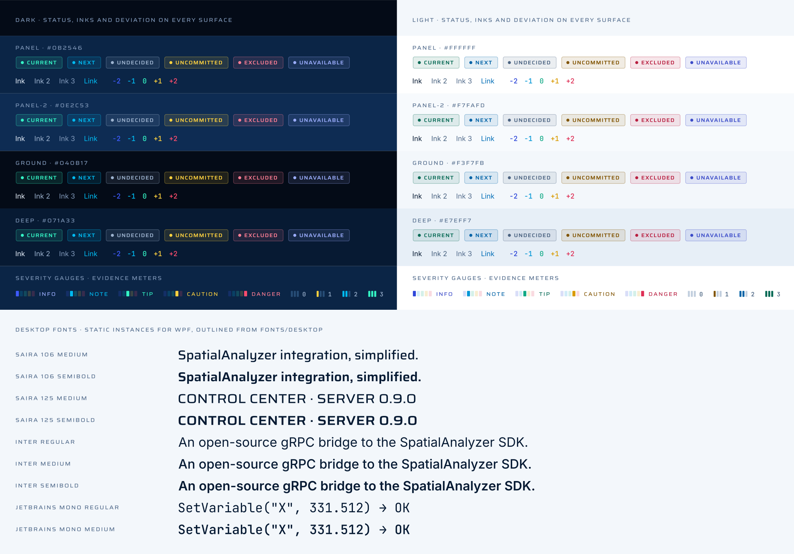

# Asset Validation

Status: **passed**. 870 of 870 automated checks passed.

Brand version: **v2.2.0**.

- 59 deliverable SVG assets were parsed and checked for vector-only content, approved solid colors, filled outlines without strokes, accessible titles/descriptions, unique IDs, and absence of external images, scripts, styles and font dependencies. Only the large cut's glow is translucent, and one-color artwork has none. No v1 plane artwork remains.
- Every exported logo, symbol and suite PNG was checked for visibility, transparent background, and unclipped artwork with safety padding.
- The outlined wordmark achieved **98.82% silhouette overlap** with FreeType's own rendering of Saira at wght 600 and wdth 125, at the same size and letter positions, supersampled to avoid hinting. This checks the outlines against the font, not the design.
- Icons at 16, 24, 32, 48, 64 and 128 px each show one solid jaw, clear of one solid beam. The measured point reaches its full color from 24 px; at 16 px it antialiases to a softer two-pixel dot, as the proof shows.
- The ICO contains six frames and preserves the favicon's 16 px frame.
- 32 text roles were measured on all four surfaces of their theme: 128 pairs, each at least 4.5:1. The 6 deviation steps below 4.5:1 on some surface are marked artwork only.
- 15 font files were checked. The WOFF2 web builds keep every table and glyph outline of their variable fonts. The 9 static desktop instances have no variation or STAT tables, carry their WPF family, style and weight, and match FreeType's rendering of the variable font at their location with at least 99.73% silhouette overlap.
- The desktop theme is a WPF resource dictionary whose colors match `colors.json` for both themes and whose type families resolve to the desktop fonts.
- Exact slogan: **SpatialAnalyzer integration, simplified.**

## Contrast

WCAG 2 contrast of every text-role token on every surface of its theme, measured from
`colors.json`. A status pill is its 10.5 px label in the status color on an 11% tint of
that color over the surface, as the browser paints it. Text needs 4.5:1.

### Dark

| Token | Color | Panel `#0B2546` | Panel 2 `#0E2C53` | Ground `#040B17` | Deep `#071A33` |
| --- | --- | --- | --- | --- | --- |
| `ink` | `#EAF3FF` | 13.72:1 | 12.48:1 | 17.61:1 | 15.58:1 |
| `ink-2` | `#9DB3CF` | 7.15:1 | 6.51:1 | 9.18:1 | 8.12:1 |
| `ink-3` | `#8199BA` | 5.27:1 | 4.79:1 | 6.76:1 | 5.98:1 |
| `link` | `#00BAF1` | 6.80:1 | 6.18:1 | 8.72:1 | 7.72:1 |
| `status-current` | `#34F5C5` | 10.98:1 | 9.98:1 | 14.09:1 | 12.46:1 |
| `status-next` | `#00BAF1` | 6.80:1 | 6.18:1 | 8.72:1 | 7.72:1 |
| `status-undecided` | `#9DB3CF` | 7.15:1 | 6.51:1 | 9.18:1 | 8.12:1 |
| `status-uncommitted` | `#FFD23F` | 10.64:1 | 9.67:1 | 13.65:1 | 12.07:1 |
| `status-excluded` | `#FF7E95` | 6.34:1 | 5.77:1 | 8.14:1 | 7.20:1 |
| `status-unavailable` | `#9CAEFF` | 7.25:1 | 6.59:1 | 9.30:1 | 8.23:1 |
| `status-current` pill | `#34F5C5` | 8.36:1 | 7.61:1 | 11.46:1 | 9.67:1 |
| `status-next` pill | `#00BAF1` | 5.58:1 | 5.03:1 | 7.54:1 | 6.36:1 |
| `status-undecided` pill | `#9DB3CF` | 5.80:1 | 5.28:1 | 7.87:1 | 6.66:1 |
| `status-uncommitted` pill | `#FFD23F` | 8.39:1 | 7.65:1 | 11.23:1 | 9.64:1 |
| `status-excluded` pill | `#FF7E95` | 5.41:1 | 4.95:1 | 7.11:1 | 6.18:1 |
| `status-unavailable` pill | `#9CAEFF` | 5.88:1 | 5.35:1 | 7.92:1 | 6.77:1 |

### Light

| Token | Color | Panel `#FFFFFF` | Panel 2 `#F7FAFD` | Ground `#F3F7FB` | Deep `#E7EFF7` |
| --- | --- | --- | --- | --- | --- |
| `ink` | `#061A33` | 17.45:1 | 16.66:1 | 16.21:1 | 15.03:1 |
| `ink-2` | `#46607E` | 6.49:1 | 6.20:1 | 6.03:1 | 5.59:1 |
| `ink-3` | `#536C8C` | 5.40:1 | 5.15:1 | 5.01:1 | 4.65:1 |
| `link` | `#006DB6` | 5.44:1 | 5.19:1 | 5.05:1 | 4.68:1 |
| `status-current` | `#076A55` | 6.56:1 | 6.26:1 | 6.09:1 | 5.65:1 |
| `status-next` | `#0062A6` | 6.37:1 | 6.08:1 | 5.92:1 | 5.48:1 |
| `status-undecided` | `#4A6280` | 6.27:1 | 5.98:1 | 5.82:1 | 5.40:1 |
| `status-uncommitted` | `#805300` | 6.66:1 | 6.35:1 | 6.18:1 | 5.73:1 |
| `status-excluded` | `#B81E40` | 6.37:1 | 6.08:1 | 5.92:1 | 5.48:1 |
| `status-unavailable` | `#3B4BC8` | 6.94:1 | 6.62:1 | 6.45:1 | 5.98:1 |
| `status-current` pill | `#076A55` | 5.58:1 | 5.32:1 | 5.17:1 | 4.82:1 |
| `status-next` pill | `#0062A6` | 5.40:1 | 5.15:1 | 5.04:1 | 4.67:1 |
| `status-undecided` pill | `#4A6280` | 5.38:1 | 5.13:1 | 5.02:1 | 4.66:1 |
| `status-uncommitted` pill | `#805300` | 5.66:1 | 5.43:1 | 5.27:1 | 4.92:1 |
| `status-excluded` pill | `#B81E40` | 5.29:1 | 5.08:1 | 4.94:1 | 4.60:1 |
| `status-unavailable` pill | `#3B4BC8` | 5.85:1 | 5.62:1 | 5.47:1 | 5.10:1 |

### Deviation Steps

A step below 4.5:1 on any surface of its theme is artwork only: use it for data,
gauges and rules, and set text in the matching status color.

| Theme | Step | Color | Panel | Panel 2 | Ground | Deep | Use |
| --- | --- | --- | --- | --- | --- | --- | --- |
| Dark | −2 | `#3E5BFF` | 3.03:1 | 2.76:1 | 3.89:1 | 3.44:1 | Artwork only |
| Dark | −1 | `#00BAF1` | 6.80:1 | 6.18:1 | 8.72:1 | 7.72:1 | Text and artwork |
| Dark | 0 | `#34F5C5` | 10.98:1 | 9.98:1 | 14.09:1 | 12.46:1 | Text and artwork |
| Dark | +1 | `#FFD23F` | 10.64:1 | 9.67:1 | 13.65:1 | 12.07:1 | Text and artwork |
| Dark | +2 | `#FF4D6D` | 4.78:1 | 4.35:1 | 6.13:1 | 5.42:1 | Artwork only |
| Light | −2 | `#2E47D9` | 6.95:1 | 6.64:1 | 6.46:1 | 5.99:1 | Text and artwork |
| Light | −1 | `#0096D6` | 3.32:1 | 3.17:1 | 3.08:1 | 2.86:1 | Artwork only |
| Light | 0 | `#10A985` | 2.98:1 | 2.85:1 | 2.77:1 | 2.57:1 | Artwork only |
| Light | +1 | `#D99A00` | 2.45:1 | 2.34:1 | 2.28:1 | 2.11:1 | Artwork only |
| Light | +2 | `#DE2F55` | 4.52:1 | 4.32:1 | 4.20:1 | 3.90:1 | Artwork only |

### Brand Inks on Their Grounds

| Foreground | Background | Ratio | Required |
| --- | --- | --- | --- |
| `dark-ink` | `void` | 17.61:1 | 7:1 |
| `dark-ink-2` | `void` | 9.18:1 | 4.5:1 |
| `dark-ink-3` | `void` | 6.76:1 | 4.5:1 |
| `dark-jaw` | `void` | 8.72:1 | 3:1 |
| `light-ink` | `clean-room` | 16.21:1 | 7:1 |
| `light-ink-2` | `clean-room` | 6.03:1 | 4.5:1 |
| `light-ink-3` | `clean-room` | 5.01:1 | 4.5:1 |
| `light-link` | `clean-room` | 5.05:1 | 4.5:1 |
| `light-jaw` | `clean-room` | 3.08:1 | 3:1 |

## Fonts

| File | Use | Bytes | Overlap with the variable font |
| --- | --- | --- | --- |
| `fonts/Saira-Variable.ttf` | Source | 483,700 |  |
| `fonts/Inter-Variable.ttf` | Source | 876,576 |  |
| `fonts/JetBrainsMono-Variable.ttf` | Source | 187,208 |  |
| `fonts/web/Saira-Variable.woff2` | Web | 172,640 |  |
| `fonts/web/Inter-Variable.woff2` | Web | 350,460 |  |
| `fonts/web/JetBrainsMono-Variable.woff2` | Web | 71,736 |  |
| `fonts/desktop/Saira106-Medium.ttf` | Desktop | 83,152 | 99.86% |
| `fonts/desktop/Saira106-SemiBold.ttf` | Desktop | 83,216 | 99.89% |
| `fonts/desktop/Saira125-Medium.ttf` | Desktop | 83,232 | 99.87% |
| `fonts/desktop/Saira125-SemiBold.ttf` | Desktop | 83,240 | 99.88% |
| `fonts/desktop/Inter-Regular.ttf` | Desktop | 341,352 | 99.73% |
| `fonts/desktop/Inter-Medium.ttf` | Desktop | 341,908 | 99.78% |
| `fonts/desktop/Inter-SemiBold.ttf` | Desktop | 342,592 | 99.79% |
| `fonts/desktop/JetBrainsMono-Regular.ttf` | Desktop | 115,032 | 99.76% |
| `fonts/desktop/JetBrainsMono-Medium.ttf` | Desktop | 115,064 | 99.81% |

## Visual Proofs

The generated preview and these proofs must also be visually inspected after a rebuild. Automated checks alone do not establish visual quality.

Detailed results: [validation.json](validation.json).
