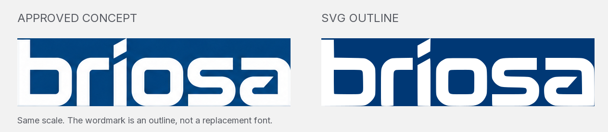

# Asset Validation

Status: **passed**. 316 of 316 automated checks passed.

Brand version: **v1**.

- 38 deliverable SVG assets were parsed and checked for vector-only content, approved solid colors, accessible titles/descriptions, unique IDs, and absence of external images, scripts and font dependencies.
- Every exported logo, symbol and suite PNG was checked for visibility, transparent background, and unclipped artwork with safety padding.
- The outlined wordmark achieved **98.60% silhouette overlap** with the selected concept at the source scale. This checks tracing fidelity, not an independent design or trademark assessment.
- Icons at 16, 24, 32, 48, 64 and 128 px retain three separate visible planes. The 16/24/32 px artwork has slightly larger gaps for optical clarity.
- The ICO contains six frames and preserves the dedicated 16 px optical artwork.
- Exact slogan: **SpatialAnalyzer integration, simplified.**

## Visual Proofs

The generated preview and these proofs must also be visually inspected after a rebuild. Automated checks alone do not establish visual quality. The original delivery was visually reviewed for shape fidelity, readable slogan placement, correct color assignment, and clear small-size icons.

Detailed results: [validation.json](validation.json).
