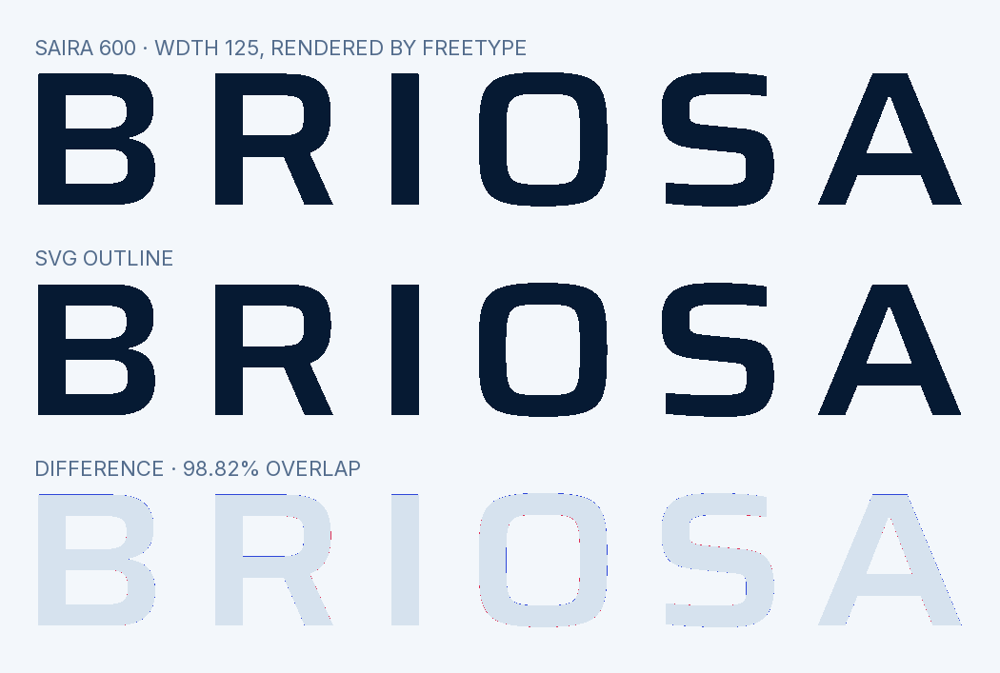
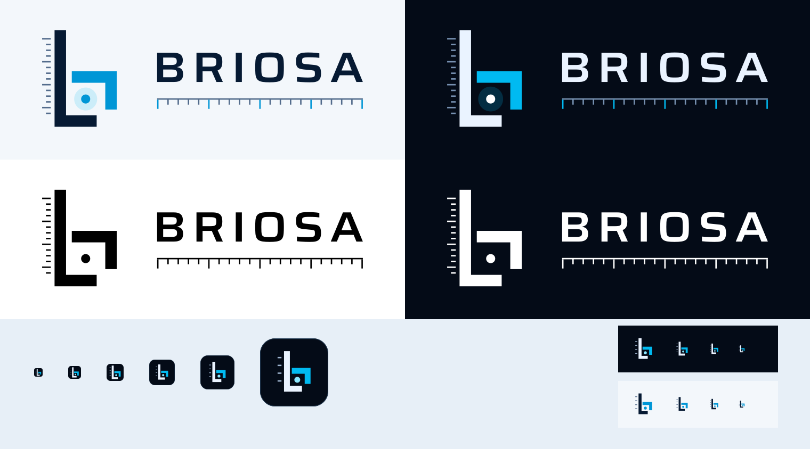

# Asset Validation

Status: **passed**. 679 of 679 automated checks passed.

Brand version: **v2.1.0**.

- 59 deliverable SVG assets were parsed and checked for vector-only content, approved solid colors, filled outlines without strokes, accessible titles/descriptions, unique IDs, and absence of external images, scripts, styles and font dependencies. Only the large cut's glow is translucent, and one-color artwork has none. No v1 plane artwork remains.
- Every exported logo, symbol and suite PNG was checked for visibility, transparent background, and unclipped artwork with safety padding.
- The outlined wordmark achieved **98.82% silhouette overlap** with FreeType's own rendering of Saira at wght 600 and wdth 125, at the same size and letter positions, supersampled to avoid hinting. This checks the outlines against the font, not the design.
- Icons at 16, 24, 32, 48, 64 and 128 px each show one solid jaw, clear of one solid beam. The measured point reaches its full color from 24 px; at 16 px it antialiases to a softer two-pixel dot, as the proof shows.
- The ICO contains six frames and preserves the favicon's 16 px frame.
- Exact slogan: **SpatialAnalyzer integration, simplified.**

## Contrast

WCAG 2 contrast of the palette's text and accent colors on their grounds.

| Foreground | Background | Ratio | Required |
| --- | --- | --- | --- |
| `dark-ink` | `void` | 17.61:1 | 7:1 |
| `dark-ink-2` | `void` | 9.18:1 | 4.5:1 |
| `dark-ink-3` | `void` | 5.99:1 | 4.5:1 |
| `dark-jaw` | `void` | 8.72:1 | 3:1 |
| `light-ink` | `clean-room` | 16.21:1 | 7:1 |
| `light-ink-2` | `clean-room` | 6.03:1 | 4.5:1 |
| `light-ink-3` | `clean-room` | 5.01:1 | 4.5:1 |
| `light-link` | `clean-room` | 5.05:1 | 4.5:1 |
| `light-jaw` | `clean-room` | 3.08:1 | 3:1 |

## Visual Proofs

The generated preview and these proofs must also be visually inspected after a rebuild. Automated checks alone do not establish visual quality.

Detailed results: [validation.json](validation.json).
